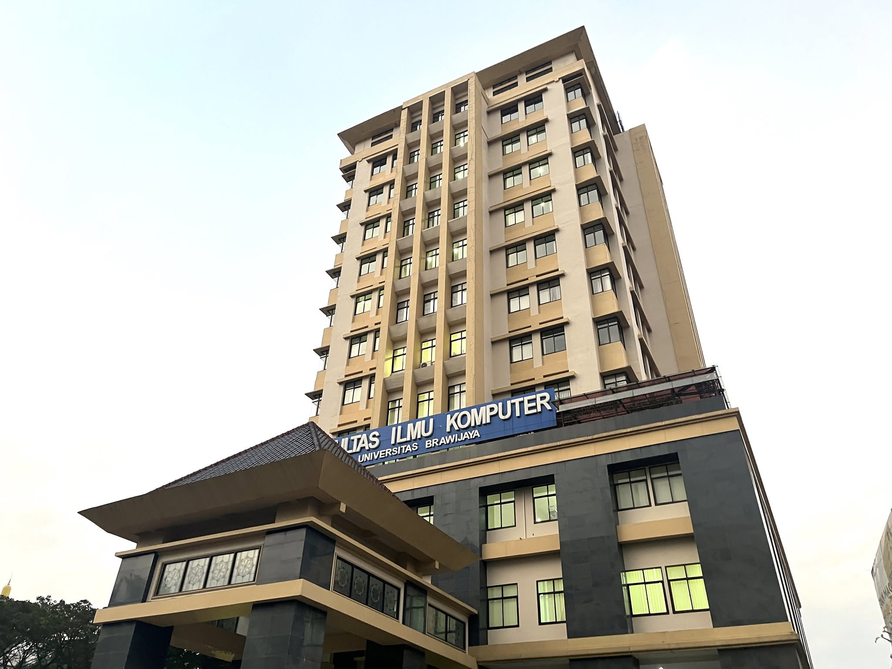
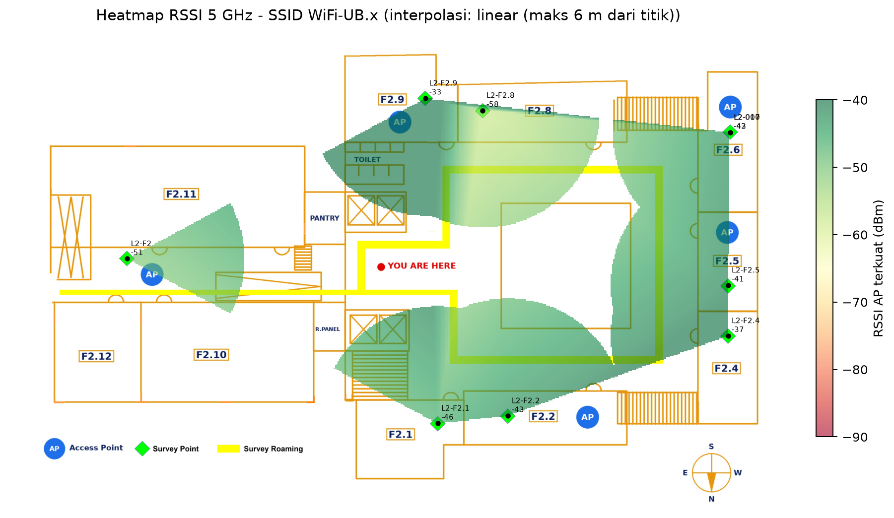
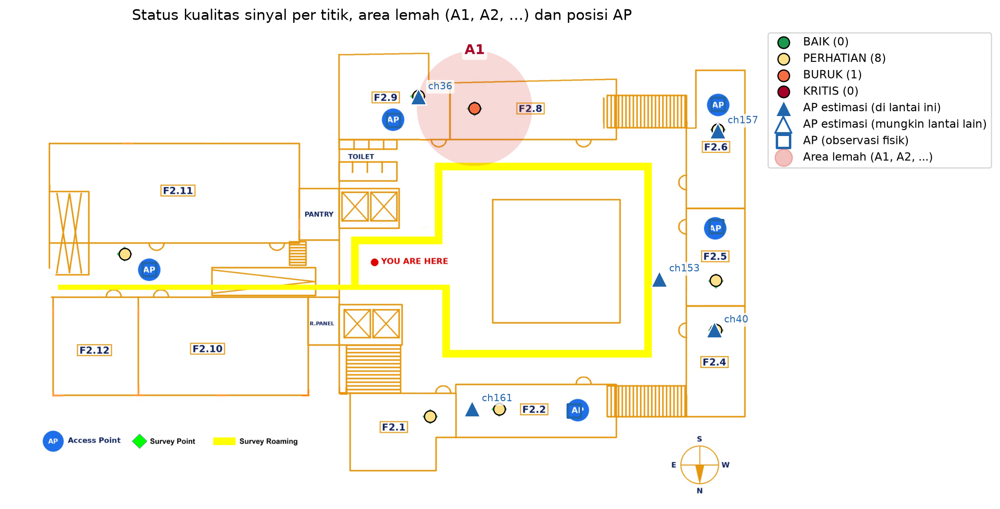
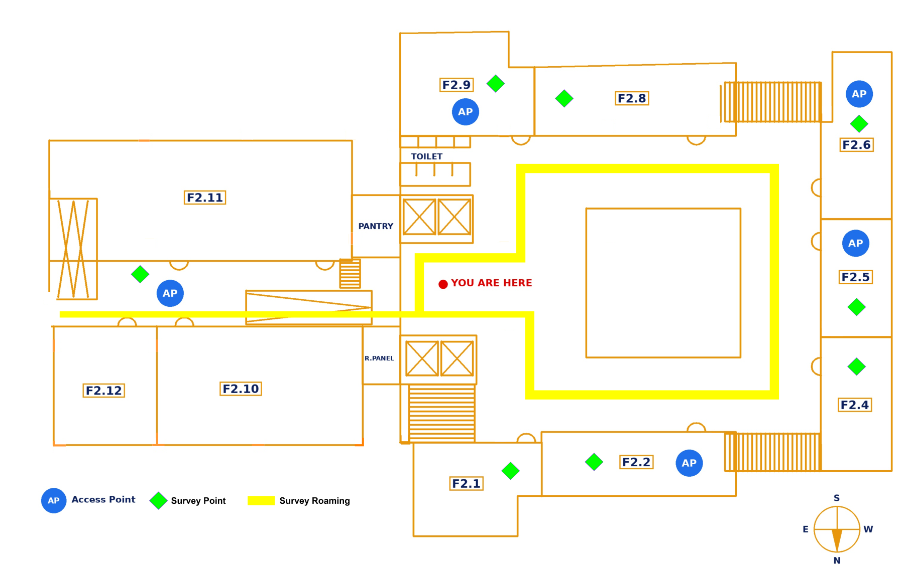

<div align="center">



# Wi-Fi Survey FILKOM

### Pemetaan kualitas sinyal Wi-Fi 5 GHz Gedung F FILKOM

Survei pasif, pengujian aktif, validasi Android, dan analisis roaming<br>
untuk SSID `WiFi-UB.x` di lantai 2 Gedung F FILKOM.

<p>
  
  
  
  
</p>

</div>

---

## Tentang project

Project ini mengolah hasil site survey Wi-Fi 5 GHz untuk menjawab tiga pertanyaan:

1. Di mana kualitas sinyal atau layanan jaringan menurun?
2. Apa penyebabnya: coverage gap, co-channel interference, beban AP, atau roaming?
3. Bagaimana posisi AP dan rekomendasi perbaikannya berdasarkan data?

Toolchain utama project:

```text
scan_point.py  ->  passive scan 5 GHz
active_point.py -> RTT, jitter, loss, dan link information
roam_log.py    -> perpindahan BSSID saat berjalan
analyze.py     -> metrik, status, heatmap, kanal, dan estimasi AP
```

## Hasil singkat lantai 2

| Metrik                                  |                       Hasil |
| --------------------------------------- | --------------------------: |
| Titik yang dianalisis                   | 9 titik + 1 titik kalibrasi |
| RSSI minimum AP terkuat                 |                   -58,0 dBm |
| Titik dengan RSSI AP terkuat >= -67 dBm |                        100% |
| Titik dengan AP cadangan >= -75 dBm     |                        100% |
| Titik dengan CCI > 2 radio              |                       44,4% |
| Area lemah yang terdeteksi              |                   `L2-F2.8` |
| Roaming transition terdeteksi           |                  8 transisi |

### Temuan utama

- **F2.8** adalah prioritas validasi: active test mencatat packet loss 100%,
  sementara WiFiAnalyzer tidak mendeteksi AP pada titik tersebut.
- **F2.6** perlu diperiksa terkait utilisasi kanal tinggi. Data controller
  historis menunjukkan utilisasi 5 GHz sebesar 92% pada AP F2.6.
- **F2.9** memiliki RSSI kuat, tetapi RTT dan jitter tinggi. Ini menunjukkan
  bahwa RSSI yang baik tidak selalu berarti kualitas layanan yang baik.
- **F2.2 dan titik sisi kiri** menunjukkan indikasi co-channel interference
  dari beberapa radio.

> Detail angka dan status per titik tersedia di
> [`analisis-l2/output/L2_ringkasan.txt`](analisis-l2/output/L2_ringkasan.txt).

## Visualisasi

### Heatmap RSSI



### Peta status, area lemah, dan posisi AP



### Denah survei



Legenda denah:

- titik biru: AP fisik;
- titik hijau: titik pengujian;
- garis kuning: lintasan pengujian roaming.

## Struktur repository

```text
.
├── active_point.py                 # Uji aktif: RTT, jitter, loss, link
├── analyze.py                      # Pipeline analisis satu lantai
├── roam_log.py                     # Pencatatan perpindahan BSSID
├── scan_point.py                   # Passive scan Wi-Fi
├── wlan_win.py                     # Native Wi-Fi API untuk Windows
├── hasil-scan/
│   ├── point/                      # Data passive dan active tiga laptop
│   └── roaming/                    # Log roaming dan ping
├── mapping/
│   ├── denah-scan-f2-filkom.png    # Denah sumber resolusi tinggi
│   ├── denah-preview.png           # Denah terukur untuk analisis
│   └── detail-sebaran-ap.csv       # Snapshot inventaris AP controller
├── mobile-wifi-analyzer/           # Validasi scan dari Android
└── analisis-l2/
    ├── input/                      # CSV gabungan untuk pipeline
    ├── output/                     # Hasil analisis dan visualisasi
    ├── titik_L2.csv                # Koordinat titik survei
    ├── ap_fisik_L2.csv             # Posisi AP yang terlihat di denah
    └── README.md                   # Catatan asumsi analisis L2
```

## Menjalankan analisis

### Persiapan environment

Project menggunakan Python 3.10+ dan library berikut:

```powershell
python -m venv .venv
.\.venv\Scripts\Activate.ps1
pip install pandas numpy scipy matplotlib
```

Jika environment `.venv` sudah tersedia:

```powershell
.\.venv\Scripts\python.exe --version
```

### Menjalankan pipeline L2

```powershell
.\.venv\Scripts\python.exe analyze.py `
  --passive analisis-l2\input\passive_L2.csv `
  --titik analisis-l2\titik_L2.csv `
  --ssid "WiFi-UB.x" `
  --band 5 `
  --denah mapping\denah-preview.png `
  --scale 46.4 `
  --out analisis-l2\output\L2 `
  --active analisis-l2\input\active_L2.csv `
  --ap-fisik analisis-l2\ap_fisik_L2.csv
```

Output akan dibuat dengan prefix `analisis-l2/output/L2`:

| File                                                                          | Kegunaan                               |
| ----------------------------------------------------------------------------- | -------------------------------------- |
| [`L2_titik.csv`](analisis-l2/output/L2_titik.csv)                             | Metrik, status, dan penyebab per titik |
| [`L2_area_lemah.csv`](analisis-l2/output/L2_area_lemah.csv)                   | Kelompok area lemah                    |
| [`L2_ap.csv`](analisis-l2/output/L2_ap.csv)                                   | Estimasi posisi radio AP               |
| [`L2_heatmap.png`](analisis-l2/output/L2_heatmap.png)                         | Heatmap RSSI AP terkuat                |
| [`L2_status.png`](analisis-l2/output/L2_status.png)                           | Status titik dan pemetaan AP           |
| [`L2_kanal.png`](analisis-l2/output/L2_kanal.png)                             | Distribusi kanal 5 GHz                 |
| [`L2_ringkasan.txt`](analisis-l2/output/L2_ringkasan.txt)                     | Ringkasan angka untuk laporan          |
| [`L2_roaming_transitions.csv`](analisis-l2/output/L2_roaming_transitions.csv) | Ringkasan perpindahan BSSID            |

## Pengumpulan data

### Passive scan

```powershell
python scan_point.py `
  --titik L2-F2.8 `
  --lantai 2 `
  --slot T1 `
  --device laptopA `
  --out hasil-scan\point\laptopA_passive_L2.csv `
  --n 3 `
  --ssid "WiFi-UB.x"
```

### Active test

Laptop harus sudah terhubung ke `WiFi-UB.x`.

```powershell
python active_point.py `
  --titik L2-F2.8 `
  --out hasil-scan\point\laptopA_active_L2.csv
```

Jika tersedia server iperf3, throughput dapat ditambahkan dengan `--iperf
<IP_SERVER>`. Pengujian dibatasi oleh skrip maksimal 8 detik per arah.

### Roaming

Jalankan pencatatan BSSID dan ping secara bersamaan:

```powershell
python roam_log.py --out hasil-scan\roaming\laptopA_roaming_L2.csv
ping -t filkom.ub.ac.id
```

Pada Windows, RSSI roaming adalah aproksimasi dari kualitas sinyal. Nilainya
digunakan untuk mendeteksi pergantian BSSID, bukan sebagai pengukuran dBm
presisi.

## Interpretasi status

`analyze.py` menggunakan beberapa ambang praktikum:

| Kondisi               | Interpretasi                            |
| --------------------- | --------------------------------------- |
| RSSI >= -67 dBm       | Baik untuk kebutuhan umum               |
| RSSI < -70 dBm        | Perhatian                               |
| RSSI < -80 dBm        | Blank spot atau sangat lemah            |
| AP kedua >= -75 dBm   | Ada redundansi untuk roaming            |
| CCI > 2 radio         | Potensi co-channel interference         |
| Utilisasi kanal > 50% | Kanal relatif padat                     |
| Loss > 2%             | Gangguan layanan yang perlu diperiksa   |
| RTT > 50 ms           | Latensi tinggi untuk konteks survei ini |

Status akhir tidak hanya ditentukan RSSI. Active test, CCI, utilisasi kanal,
dan packet loss juga dapat menaikkan status titik menjadi `PERHATIAN` atau
`BURUK`.

## Batasan dan catatan metodologi

- Dataset saat ini berfokus pada lantai 2 dan memiliki 10 titik lapangan,
  belum mencapai target panduan 25–35 titik per lantai.
- Koordinat L2 dibuat dari posisi relatif pada denah, bukan hasil klik
  `mark_points.py`; interpretasi spasial harus dianggap aproksimasi.
- `L2-017` dipetakan ke lokasi F2.6 berdasarkan klarifikasi survei.
- `L2-F2` adalah titik hijau tanpa label di sisi kiri denah.
- `L2-000` dipertahankan sebagai titik kalibrasi.
- Windows tidak menyediakan `noise_dbm` pada dataset ini, sehingga SNR tidak
  dapat dianalisis.
- Snapshot controller AP memiliki waktu pengambilan yang berbeda dari waktu
  survei; gunakan sebagai referensi, bukan kondisi real-time.
- Tidak ada data throughput iperf3 pada hasil saat ini. Analisis aktif
  menggunakan RTT, jitter, packet loss, RSSI, dan tx rate.
- Interpolasi heatmap hanya berlaku di sekitar titik yang memiliki pengukuran;
  area tanpa titik tidak boleh dianggap memiliki kualitas yang sama.

## Etika survei

Survei dilakukan secara pasif dan hanya pada jaringan yang memang berhak
digunakan. Project ini tidak melakukan deauthentication, jamming, rogue AP,
cracking, packet capture terhadap pengguna lain, atau flooding.

## Referensi

- Panduan praktikum: [`Hands-on_Survey_WiFi_FILKOM.md`](https://github.com/3k0sakti/wifi-scan/blob/main/Hands-on_Survey_WiFi_FILKOM.md)
